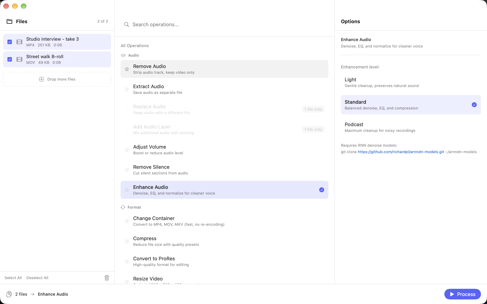

<p></p>

<h1>Mediabox</h1>

<p>A free ffmpeg app for Mac.<br>
Convert, compress, trim and batch-process video and audio by drag and drop.</p>

<p><strong>Version 2.0.1</strong> · macOS 13+ · Apple Silicon & Intel</p>

<p>
  
  
  
  
</p>

<p><a href="https://github.com/madebysan/mediabox/releases/latest">Download Mediabox</a></p>



Mediabox puts 31 common [ffmpeg](https://ffmpeg.org) jobs behind a three-panel window, for people who need a quick conversion and not an editing timeline.

- Drop in a folder and run one operation on every file at once.
- Copies streams instead of re-encoding whenever it can, so changing a container is fast and lossless.
- Writes results next to the originals and never overwrites a file.

## How it works

Drop files on the left, pick an operation in the middle (search them, or star favorites), set its options on the right and click **Process**. Operations cover audio (extract, replace, normalize, remove silence, denoise), format (compress, ProRes, resize, proxies), editing (trim, speed, reverse, crop to vertical), splitting, exports (GIF, frames, contact sheet) and overlays (merge, burn subtitles, picture-in-picture). The full list is in [docs/operations.md](docs/operations.md).

## Install

Install ffmpeg first (`brew install ffmpeg`), then download Mediabox from the [latest release](https://github.com/madebysan/mediabox/releases/latest) and drag it to Applications. It's signed and notarized and updates itself through [Sparkle](https://sparkle-project.org). Enhance Audio also needs the [arnndn models](https://github.com/richardpl/arnndn-models) cloned to `~/arnndn-models`.

## Build from source

Open `VideoAudioSuite.xcodeproj` in Xcode and press **Cmd+R**, or build from the command line. The built app is named Mediabox.

```bash
xcodebuild build -project VideoAudioSuite.xcodeproj -scheme VideoAudioSuite -configuration Debug -destination 'platform=macOS'
```

Run the unit and UI tests with the same arguments and `test` instead of `build`. Add `-only-testing:VideoAudioSuiteTests` or `-only-testing:VideoAudioSuiteUITests` to run one suite.

Contributions are welcome: fork the repo, make one focused change per pull request, and run the tests before you open it.

---

[MIT](LICENSE). Mediabox uses [Sparkle](https://github.com/sparkle-project/Sparkle); its license is in [THIRD_PARTY_NOTICES.md](THIRD_PARTY_NOTICES.md).

Made by [santiagoalonso.com](https://santiagoalonso.com)
